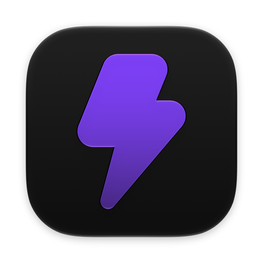
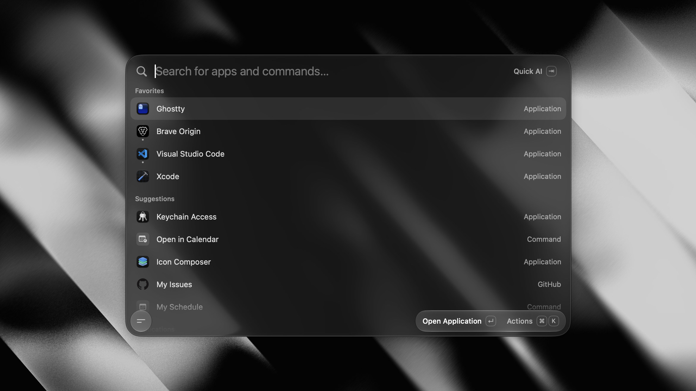

<h1 align="center">
  <a href="https://tinycast.dev"></a><br>
  Tinycast
</h1>

> **tinycast-cn** 是面向中文用户的分支：完成了全量简体中文界面汉化，为中文应用名新增全拼与首字母搜索，
> 并基于上游发布版本构建 Universal（`arm64` + `x86_64`）安装包。产品名仍为 **Tinycast**。
>
> ```sh
> brew trust --tap conversun/tinycast-cn   # 第三方 tap 需要先信任
> brew tap conversun/tinycast-cn
> brew install --cask tinycast-cn
> ```
>
> 后续通过应用内更新器升级；不支持 CN 更新器的旧版可先运行
> `brew update && brew upgrade --cask --greedy tinycast-cn`。装成 `Tinycast.app`，与上游
> `tinycast`、`tinycast-universal`、`tinycast-sequoia` 占用同一路径，只能安装其中一个。

<p align="center">
  A native macOS launcher for everyday productivity. Lightweight and open source.
</p>

<p align="center">
  <a href="https://tinycast.dev"><strong>Website</strong></a> ·
  <a href="#install"><strong>Install</strong></a> ·
  <a href="https://tinycast.dev/docs/"><strong>Docs</strong></a> ·
  <a href="https://tinycast.dev/support"><strong>Support</strong></a>
</p>

<p align="center">
  <a href="https://github.com/abue-ammar/tinycast/releases/latest"><picture><source media="(prefers-color-scheme: dark)" srcset="https://shieldcn.dev/github/release/abue-ammar/tinycast.svg?variant=ghost&amp;font=geist-mono&amp;mode=dark&amp;label=RELEASE&amp;logo=lu:Tag&amp;valueColor=60A5FA" /></picture></a>
  <a href="https://github.com/abue-ammar/tinycast/releases"><picture><source media="(prefers-color-scheme: dark)" srcset="https://shieldcn.dev/github/downloads/abue-ammar/tinycast.svg?variant=ghost&amp;font=geist-mono&amp;mode=dark&amp;label=DOWNLOADS&amp;logo=lu:CloudDownload&amp;valueColor=A78BFA" /></picture></a>
  <a href="https://github.com/abue-ammar/tinycast/actions/workflows/release.yml"><picture><source media="(prefers-color-scheme: dark)" srcset="https://shieldcn.dev/github/ci/abue-ammar/tinycast.svg?variant=ghost&amp;font=geist-mono&amp;mode=dark&amp;workflow=release.yml&amp;label=BUILD&amp;logo=lu:Hammer&amp;valueColor=4ADE80" /></picture></a>
  <a href="https://discord.gg/v2Eeb4QQy3"><picture><source media="(prefers-color-scheme: dark)" srcset="https://shieldcn.dev/badge/DISCORD-JOIN.svg?variant=ghost&amp;font=geist-mono&amp;mode=dark&amp;logo=discord&amp;valueColor=A5B4FC" /></picture></a>
  <br>
  <picture><source media="(prefers-color-scheme: dark)" srcset="https://shieldcn.dev/badge/MACOS-26%2B.svg?variant=ghost&amp;font=geist-mono&amp;mode=dark&amp;logo=apple" /></picture>
  <picture><source media="(prefers-color-scheme: dark)" srcset="https://shieldcn.dev/badge/SWIFT-6.svg?variant=ghost&amp;font=geist-mono&amp;mode=dark&amp;logo=swift&amp;valueColor=FB923C" /></picture>
  <a href="LICENSE"><picture><source media="(prefers-color-scheme: dark)" srcset="https://shieldcn.dev/badge/LICENSE-AGPL--3.0.svg?variant=ghost&amp;font=geist-mono&amp;mode=dark&amp;logo=lu:Scale" /></picture></a>
</p>

<p align="center">
  
</p>

Built with SwiftUI and AppKit. No dependencies, no Electron, no telemetry. It runs your Raycast
extensions, too.

[Explore all features →](https://tinycast.dev/#features)

For anything private, feel free to email [iabueammar@gmail.com](mailto:iabueammar@gmail.com).

## Install

```sh
brew trust --tap conversun/tinycast-cn   # required for third-party taps
brew tap conversun/tinycast-cn
brew install --cask tinycast-cn
```

Updates install through the CN in-app updater. For older builds without CN updater support,
run `brew update && brew upgrade --cask --greedy tinycast-cn` once.

This is the Chinese build, installed as `Tinycast.app` — the same path the upstream `tinycast`,
`tinycast-universal` and `tinycast-sequoia` casks own, so the cask conflicts with all three. Pick
one, or install the upstream `tinycast@beta` alongside it (that one is `Tinycast Beta.app`).

Tinycast is self-signed. Installing via Homebrew clears the macOS quarantine flag for you
automatically on every install and update, so there's nothing to run. (If you download the DMG
directly from Releases instead, clear it once: `xattr -dr com.apple.quarantine
"/Applications/Tinycast.app"`.)

## Permissions

**Accessibility** — needed when Tinycast pastes or expands text into another app, and the only
permission snippet keyword expansion needs. You're prompted when you first use a feature that needs
it; grant access in **System Settings → Privacy & Security → Accessibility**. Snippets ship
disabled, and keystrokes are matched locally, never stored and never sent anywhere.

## Using it

1. Open **Settings → General** and record a global shortcut to summon Tinycast.
2. Press it anywhere → the palette floats in. Type to filter, **↵** to launch.
3. **Tab** switches between Apps and Clipboard; **↑/↓** move, **Esc** dismisses.
4. **Settings → Shortcuts** — search an app or custom command and record a global shortcut.
5. **Settings → Snippets** — enable the feature, then create templates with expansion keywords.

## Building from source

See **[docs/development.md](docs/development.md)** for the toolchain, build, packaging, release and
website workflows. **[docs/](docs/README.md)** indexes everything else — architecture, engineering
standards, the design system and one document per feature.

## Support

Tinycast is free and stays free. If it earns a place on your Mac, consider supporting its
development. Thank you!

<p align="center">
  <a href="https://tinycast.dev/support"><picture><source media="(prefers-color-scheme: dark)" srcset="https://shieldcn.dev/badge/SUPPORT-CARD.svg?variant=outline&amp;size=lg&amp;font=geist-mono&amp;mode=dark&amp;logo=lu:CircleDollarSign&amp;logoColor=A78BFA&amp;valueColor=A78BFA" /></picture></a>
  <a href="https://tinycast.dev/support?method=crypto"><picture><source media="(prefers-color-scheme: dark)" srcset="https://shieldcn.dev/badge/SUPPORT-CRYPTO.svg?variant=outline&amp;size=lg&amp;font=geist-mono&amp;mode=dark&amp;logo=lu:Bitcoin&amp;logoColor=FBBF24&amp;valueColor=FBBF24" /></picture></a>
</p>

## License

Tinycast is licensed under the [AGPL-3.0 license](LICENSE).
