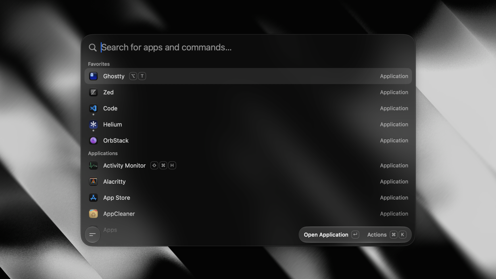

# Tinycast

> **tinycast-cn** 是面向中文用户的分支：完成了全量简体中文界面汉化，为中文应用名新增全拼与首字母搜索，
> 并基于上游发布版本构建 Universal（`arm64` + `x86_64`）安装包。产品名仍为 **Tinycast**。
>
> ```sh
> brew trust --tap conversun/tinycast-cn   # 第三方 tap 需要先信任
> brew tap conversun/tinycast-cn
> brew install --cask tinycast-cn
> ```
>
> 后续通过应用内更新器升级；不支持 CN 更新器的旧版可先运行
> `brew update && brew upgrade --cask --greedy tinycast-cn`。装成 `Tinycast.app`，与上游
> `tinycast`、`tinycast-universal`、`tinycast-sequoia` 占用同一路径，只能安装其中一个。

**A tiny, fully native macOS launcher. One hotkey, everything you reach for all day, under 100 MB of
RAM.**

<p align="center">
  <a href="https://github.com/abue-ammar/tinycast/releases/latest">
    </a>
  
  
  <a href="LICENSE">
    </a>
  <a href="https://discord.gg/v2Eeb4QQy3">
    </a>
</p>

SwiftUI and AppKit, **zero third-party dependencies**, no Electron and no telemetry. It also **runs
real Raycast extensions**, rendered as native SwiftUI. Free, open source, and staying that way.

For anything private, email [iabueammar@gmail.com](mailto:iabueammar@gmail.com).

<p align="center">
  
</p>

## Features

- **App launcher** — fuzzy-search and launch anything, pin favorites, see what's running, quit an app
  or every app at once.
- **Global hotkey** — one shortcut summons the palette from anywhere.
- **Per-app hotkeys** — bind a key to an app; press it to toggle (focus/hide).
- **Search Files** — open files and folders from the folders you choose, using Tinycast's own live
  disk index, with results also available in the launcher.
- **Dictionary** — look a word up with the Define Word command, or define whatever you typed from the
  launcher's fallbacks, read from the Mac's own dictionaries.
- **Clipboard history** — text and images, searchable, pasted back into the app you were using.
- **Calculator** — do math, unit, live currency and crypto conversions inline, right in the palette.
- **Quicklinks** — turn a URL, search, file or deeplink into a command, with placeholders for typed
  input, the clipboard or the date.
- **Apple Shortcuts** — search and run the shortcuts you built in the Shortcuts app, with aliases and
  global hotkeys.
- **Snippets** — reusable Markdown templates with dynamic placeholders, arguments, nested references
  and optional keyword expansion.
- **Custom commands** — run named shell commands through fuzzy search or their own global hotkeys.
- **Window management** — 34 Rectangle-style actions: halves, quarters, thirds, sizing, nudging,
  display moves, fullscreen and Spaces.
- **System actions** — lock, sleep, restart, empty trash, toggle appearance, Bluetooth, mute, hidden
  files, and more.
- **Calendar and meetings** — your next meeting on the empty palette and in the menu bar, one key to
  join it, or let it join itself.
- **Notes** — an unlimited collection of plain Markdown files in one floating editor, searchable from
  the palette and rendered as you write.
- **Emoji picker** — a searchable emoji grid, one keystroke away.
- **AI chat** — use your own key or an installed AI account: ask Quick AI from the palette, or keep
  longer conversations in the AI Chat window, with a searchable, pinnable history. Off out of the box,
  like every AI feature.
- **Quick Actions** — fix grammar, rewrite, translate or summarize the selected text in any app.
- **Raycast extensions** — run the ones you already have natively, rendered as SwiftUI.
- **Backup and import** — export your settings to a file, or import your setup from Raycast.

## Install

```sh
brew trust --tap conversun/tinycast-cn   # required for third-party taps
brew tap conversun/tinycast-cn
brew install --cask tinycast-cn
```

Updates install through the CN in-app updater. For older builds without CN updater support,
run `brew update && brew upgrade --cask --greedy tinycast-cn` once.

This is the Chinese build, installed as `Tinycast.app` — the same path the upstream `tinycast`,
`tinycast-universal` and `tinycast-sequoia` casks own, so the cask conflicts with all three. Pick
one, or install the upstream `tinycast@beta` alongside it (that one is `Tinycast Beta.app`).

Tinycast is self-signed. Installing via Homebrew clears the macOS quarantine flag for you
automatically on every install and update, so there's nothing to run. (If you download the DMG
directly from Releases instead, clear it once: `xattr -dr com.apple.quarantine
"/Applications/Tinycast.app"`.)

## Permissions

**Accessibility** — needed when Tinycast pastes or expands text into another app, and the only
permission snippet keyword expansion needs. You're prompted when you first use a feature that needs
it; grant access in **System Settings → Privacy & Security → Accessibility**. Snippets ship
disabled, and keystrokes are matched locally, never stored and never sent anywhere.

## Using it

1. Open **Settings → General** and record a global shortcut to summon Tinycast.
2. Press it anywhere → the palette floats in. Type to filter, **↵** to launch.
3. **Tab** switches between Apps and Clipboard; **↑/↓** move, **Esc** dismisses.
4. **Settings → Shortcuts** — search an app or custom command and record a global shortcut.
5. **Settings → Snippets** — enable the feature, then create templates with expansion keywords.

## Building from source

See **[docs/development.md](docs/development.md)** for the toolchain, build, packaging, release and
website workflows. **[docs/](docs/README.md)** indexes everything else — architecture, engineering
standards, the design system and one document per feature.

## Support

Tinycast is **free, and it stays that way**. If you enjoy it, you can support it with crypto: scan a
code with your wallet, or copy an address. Send only on the network named for that address. If yours
isn't listed, [email me](mailto:iabueammar@gmail.com?subject=Supporting%20Tinycast).

<table>
  <tr>
    <td align="center">
      <br>
      <b>Bitcoin</b>
    </td>
    <td align="center">
      <br>
      <b>Ethereum, Base, BNB Smart Chain</b>
    </td>
    <td align="center">
      <br>
      <b>Solana</b>
    </td>
  </tr>
</table>

**Bitcoin**

```text
bc1qpfxtjpuhm2cm8kg4lqgu3ffjch7vcjf678arwn
```

**Ethereum, Base and BNB Smart Chain** (one address for all three)

```text
0x22A00612bc0bf1Dc73AAC75e8De1BA4e81fF0810
```

**Solana**

```text
4EH7JDXZxkJiahas1xgPyC1iBW9pfCVUXxVtpqvwAz6T
```

Prefer a card? Buy the wallpaper pack and get a Discord role.

<p align="center">
  <a href="https://tinycast.dev/support">
    </a><br>
  <sub>Card payments are handled securely by <a href="https://polar.sh">Polar.sh</a>.</sub>
</p>

## License

[AGPL-3.0](LICENSE)
